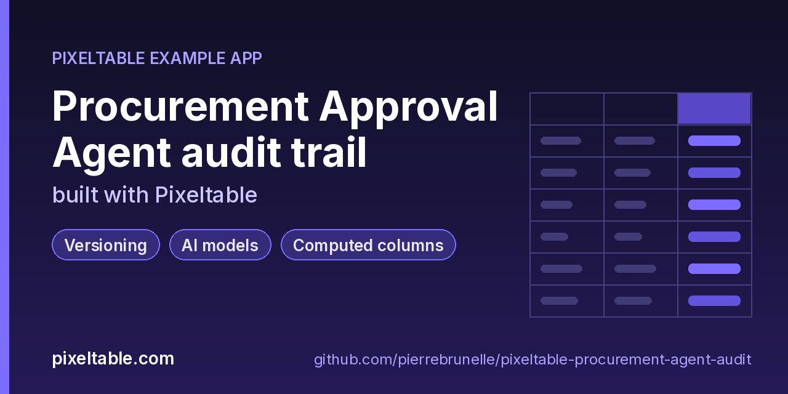

<!-- pixeltable-example-app: 20261025-procurement-agent-audit -->
# Build a time-travel audit log for AI agent decisions in Python

**Short answer:** make the agent a computed column. Store each purchase request in a Pixeltable table with the active `policy_version`; `openai.chat_completions` (`gpt-4o-mini`, JSON output) decides approve / escalate / reject, a UDF parses the verdict and a deterministic guardrail caps what it may approve. Pixeltable versions every insert, update and schema change, so changing the policy (one `update`) re-decides every request as a new table version. `pxt.get_table('procure/requests:N')` reads the decisions exactly as they were at version N, `revert()` undoes a bad rollout, and `pxt.create_snapshot` keeps a named copy for the auditors. No trace store, no separate versioned database.

**Replaces:** LangSmith traces + a separate versioned store (lakeFS / Dolt)

**Use case:** [pixeltable.com/learn/what-is-dataset-versioning](https://pixeltable.com/learn/what-is-dataset-versioning)



[](https://codespaces.new/pierrebrunelle/pixeltable-procurement-agent-audit?quickstart=1)
[](https://pixeltable.com)
[](https://pypi.org/project/pixeltable/)
[](https://github.com/pixeltable/pixeltable)
[](LICENSE)

`Requests` holds purchase requests (`request_id` primary key, requester, department, vendor and whether it is on the approved list, item, amount, justification, `policy_version`). Computed columns build the agent's prompt from the named policy (`agent_messages`), call `gpt-4o-mini` (`openai.chat_completions`, JSON output), parse `{verdict, reason, confidence}` (`parse_decision`), apply a deterministic `guardrail` (CFO limit, unapproved vendor) and produce the `final` decision; `spend_band` and `pixeltable.functions.timestamp.strftime` add reporting columns. `Overrides` records human reviewer overrides keyed to the `Requests` version they were made against, and `Escalations` is a view of what a human must review now. `audit.py` (argparse, no HTTP router) runs the audit workflow: `policy` re-decides every request under another policy in one `update` (one new version), `approvals-over` samples big approvals, `rollback` calls `revert()`, `as-of N` reads a past version, `why` prints one request's decision trail across every version (plus overrides), `diff A B` lists decisions that changed, `snapshot` freezes a named copy and `escalations` reads the view. The schema itself evolves with `pxt schema diff` / `pxt schema update` (adding `cost_center`, `band`, an index and the view), and the old versions keep their old columns.

[Pixeltable](https://pixeltable.com) is open-source, Python-native **multimodal AI data infrastructure**: tables, incremental computed columns, UDFs, indexes and serving in one library, running locally or on Pixeltable Cloud.

> ⭐ **Like this example?** Star [pixeltable/pixeltable](https://github.com/pixeltable/pixeltable) on GitHub. It helps other developers find it.

## What this example shows

- **Incremental computed columns** powered by plain Python UDFs (`@pxt.udf`)
- **`pxt` CLI and local dashboard** for exploring tables and computed columns
- **B-tree indexes** declared on the model (`__indexes__`) back the lookup queries
- **Versioning**: table history, snapshots and revert for an auditable trail
- **AI provider functions** as computed columns
- **Importable UDF module**: UDFs live in `udfs.py`; tables and queries live in `app.py` (Pixeltable resolves UDFs by module path)
- **`pixeltable.toml`** declares a local database and a **Pixeltable Cloud** database, so the same code deploys with `pxt db update`

## Versioning at a glance

| Need | Python | CLI |
|---|---|---|
| Version timeline | `requests.history()` / `requests.get_versions()` | `pxt history procure/requests -n 10` |
| Read an old version (read-only) | `pxt.get_table('procure/requests:3')` | `pxt rows procure/requests:3`, `pxt count procure/requests:3` |
| Undo the last change | `requests.revert()` | `pxt revert procure/requests -n`, then `-f` |
| Keep a named copy | `pxt.create_snapshot('procure_snapshots/q4', requests)` | `pxt describe procure_snapshots/q4` |
| Evolve the schema | edit `app.py` | `pxt schema diff app.py procure`, then `pxt schema update app.py procure` (`--allow-destructive` to drop a column) |
| Short paths | | `pxt cd procure`, `pxt pwd`, then `pxt count requests:1` |

## Notes

- A policy change is one `update` on `policy_version`; Pixeltable recomputes the prompt, the model call and every dependent column for the updated rows only, and records it as one version.
- The guardrail is plain Python and runs after the model: the agent can never approve a request at or above the CFO limit or from an unapproved vendor, whatever the prompt says.
- The update count in `history()` for `requests` includes rows propagated to its views (here `escalations`), so it can exceed the number of rows in the table.
- Keep snapshots outside the schema directory (`procure_snapshots/`, not `procure/`): `pxt schema prune app.py procure` drops tables under `procure/` that `app.py` does not define. On Pixeltable Cloud the tables sit at the database root, so `audit.py --target pxt://<your-org>:<your-db>` puts snapshots in `snapshots/` there; `pxt schema prune` on that database would drop them too.

## What's inside

| File | What it is |
|------|------------|
| `.devcontainer/devcontainer.json` | GitHub Codespaces / Dev Container config: Python 3.12, installs `requirements.txt` |
| `.github/social-preview.png` | Social preview image (1280x640) |
| `CITATION.cff` | Citation metadata (authors, license, release date, keywords) |
| `app.py` | Tables declared as Python classes and `@pxt.query` functions |
| `audit.py` | Audit CLI for the procurement approval agent: seed, re-decide under a policy, override, explain, time travel |
| `pixeltable.toml` | Project config: the local database plus a Pixeltable Cloud database (sizing, deploy excludes) |
| `udfs.py` | Pixeltable UDFs (`@pxt.udf`) in their own importable module, imported by `app.py` |
| `requirements.txt` / `pyproject.toml` | Dependencies (`pixeltable>=0.7.20`) |

**Tables**

| Table | Stored columns | Computed columns |
|-------|---------|------------------|
| `requests` | `request_id`, `requester`, `department`, `cost_center`, `vendor`, `vendor_approved`, `item`, `amount`, `justification`, `submitted_at`, `policy_version` | `messages`, `response`, `decision`, `verdict`, `guard`, `final`, `band`, `submitted_day` |
| `overrides` | `request_id`, `reviewer`, `agent_said`, `override_to`, `reason`, `requests_version`, `at` | - |
| `escalations` | - | `why` |

## Run in your browser (GitHub Codespaces)

[](https://codespaces.new/pierrebrunelle/pixeltable-procurement-agent-audit?quickstart=1)

1. Click **Open in GitHub Codespaces** above (or [this link](https://codespaces.new/pierrebrunelle/pixeltable-procurement-agent-audit?quickstart=1)). The dev container installs Python 3.12 and `pixeltable>=0.7.20` from `requirements.txt`.
2. In the codespace terminal, create the tables, seed them and run the app:

   ```bash
   pxt schema update app.py procure
   export OPENAI_API_KEY=...                   # the agent is gpt-4o-mini (about 10 calls per policy run)
   python audit.py seed                         # 10 purchase requests decided under p1-strict
   python audit.py snapshot q4-p1-baseline      # named read-only copy under procure_snapshots/
   python audit.py policy p2-lenient            # a bad rollout: approve everything under 50k
   python audit.py approvals-over 5000          # what slipped through
   python audit.py rollback                     # revert() the rollout; the version is gone for good
   python audit.py policy p3-balanced           # the corrected policy
   python audit.py override PR-1009 approve --reviewer dana --reason "budgeted in the Q4 plan"
   python audit.py why PR-1005                  # escalate under p1-strict -> approve under p3-balanced
   python audit.py history                      # version timeline
   python audit.py as-of 1                      # every decision exactly as it was at version 1
   python audit.py diff 1 3                     # which decisions changed between two versions
   python audit.py escalations                  # the Escalations view
   ```


## Quickstart

Requires Python 3.11+ and `pixeltable>=0.7.20`.

```bash
git clone https://github.com/pierrebrunelle/pixeltable-procurement-agent-audit.git
cd pixeltable-procurement-agent-audit
python -m venv .venv && source .venv/bin/activate
pip install -r requirements.txt

# Create the tables in a local catalog directory named `procure`
pxt schema update app.py procure

export OPENAI_API_KEY=...                   # the agent is gpt-4o-mini (about 10 calls per policy run)
python audit.py seed                         # 10 purchase requests decided under p1-strict
python audit.py snapshot q4-p1-baseline      # named read-only copy under procure_snapshots/
python audit.py policy p2-lenient            # a bad rollout: approve everything under 50k
python audit.py approvals-over 5000          # what slipped through
python audit.py rollback                     # revert() the rollout; the version is gone for good
python audit.py policy p3-balanced           # the corrected policy
python audit.py override PR-1009 approve --reviewer dana --reason "budgeted in the Q4 plan"
python audit.py why PR-1005                  # escalate under p1-strict -> approve under p3-balanced
python audit.py history                      # version timeline
python audit.py as-of 1                      # every decision exactly as it was at version 1
python audit.py diff 1 3                     # which decisions changed between two versions
python audit.py escalations                  # the Escalations view
```

## Deploy to Pixeltable Cloud

The same `app.py` runs on [Pixeltable Cloud](https://pixeltable.com). Sign in (or get a free trial database with `pxt new`), point the second database entry in `pixeltable.toml` at your own database, then deploy:

```bash
pxt login                       # or: export PIXELTABLE_API_KEY=<your-api-key>
# edit pixeltable.toml: name = 'pxt://<your-org>:<your-db>'
pxt db update pxt://<your-org>:<your-db>                 # build the image and upload the project
pxt schema update app.py pxt://<your-org>:<your-db>       # create the tables at the database root (no per-app folder)
```

Keep keys in environment variables or `pxt secret set`, never in code.

## Code walkthrough

**1. Business logic is plain Python, in `udfs.py`.** A `@pxt.udf` function can be used as a column expression. Pixeltable records UDFs by module path (`udfs.agent_messages`), so they live in their own importable module rather than inline in the app: the daemon, serving workers and Pixeltable Cloud import it again by that path.

```python
# udfs.py
@pxt.udf
def agent_messages(
    policy_version: str, department: str, vendor: str, vendor_approved: bool, item: str, amount: float,
    justification: str,
) -> list[dict]:
    """Chat messages for one purchase request under one approval policy."""
    policy = POLICIES.get(policy_version, POLICIES['p1-strict'])
    system = (
        'You are a procurement approval agent. Follow the policy exactly. Answer with JSON only: '
        '{"verdict": "approve" | "escalate" | "reject", "reason": "<one sentence>", "confidence": <0..1>}.\n'
        f'Policy {policy_version}: {policy}'
    )
    user = (
        f'Department: {department}\nVendor: {vendor} ({"approved" if vendor_approved else "NOT on the approved list"})\n'
        f'Item: {item}\nAmount: {amount:.2f} USD\nJustification: {justification}'
    )
    return [{'role': 'system', 'content': system}, {'role': 'user', 'content': user}]
```

**2. Tables are Python classes (`app.py`).** Annotated attributes are stored columns; attributes assigned an expression are **computed columns** (`messages`, `response`, `decision`, `verdict`, `guard`, `final`, `band`, `submitted_day`), evaluated incrementally on every insert or update and recomputed when their inputs change. Indexes live next to the columns.

```python
# app.py
class Requests(TableModel, name='requests'):
    """One purchase request and the agent's current decision on it."""

    request_id = pxt.Column(type=pxt.String, primary_key=True)
    requester: pxt.String
    department: pxt.String
    cost_center: pxt.String | None
    vendor: pxt.String
    vendor_approved: pxt.Bool
    item: pxt.String
    amount: pxt.Float
    justification: pxt.String
    submitted_at: pxt.Timestamp
    policy_version: pxt.String

    messages = agent_messages(policy_version, department, vendor, vendor_approved, item, amount, justification)
    response = openai.chat_completions(
        messages, model=AGENT_MODEL,
        model_kwargs={'response_format': DECISION_FORMAT, 'max_tokens': 120, 'temperature': 0},
    )
    decision = parse_decision(response.choices[0].message.content.astype(pxt.String))
    verdict = decision.verdict.astype(pxt.String)
    guard = guardrail(amount, vendor_approved)
    final = final_decision(verdict, guard)
    band = spend_band(amount)
    submitted_day = pxtf.timestamp.strftime(submitted_at, '%Y-%m-%d')

    __indexes__ = [pxt.BtreeIndex(final), pxt.BtreeIndex(department)]
```

**3. Queries are functions (`app.py`).** `@pxt.query` wraps a Pixeltable query so it can be called from Python or exposed as a route:

```python
# app.py
@pxt.query
def decisions_by_department(department: str):
    """Current decisions for one department, biggest spend first."""
    return (
        Requests.where(Requests.department == department)
        .order_by(Requests.amount, asc=False)
        .select(Requests.request_id, Requests.item, Requests.amount, Requests.final, Requests.policy_version)
    )
```

## FAQ

**How do I keep an audit log of AI agent decisions in Python?**

Make the agent call a computed column on a Pixeltable table. Every insert, update and schema change creates a new table version automatically, so the table is the audit log: `t.history()` lists the versions and `pxt.get_table('procure/requests:N')` reads any of them back, read-only, with the prompt, the raw model response and the parsed decision for every row.

**How do I see why the agent decided something last week?**

Open the version from that time and select the row: the prompt (`messages`), the raw `response` and the parsed `decision.reason` are stored columns, so nothing has to be re-run. `python audit.py why PR-1005` walks every version and prints only the versions where the decision changed, plus any human override.

**How do I undo a bad prompt or policy rollout?**

If the rollout is the latest change, `t.revert()` (or `pxt revert procure/requests -f`) removes that version, data and schema together; `pxt revert -n` shows what would be undone first. Reverted versions are gone for good and their version number is reused by the next change, so if you record version numbers elsewhere, record them after the fact or snapshot before risky changes.

**Does this replace LangSmith or a versioned store like lakeFS or Dolt?**

For decision auditing, yes: inputs, prompts, model output and the final decision live in one versioned table you can query with Python or the `pxt` CLI. You still can export traces with Pixeltable's OpenTelemetry instrumentation if you want spans in an observability tool.

**What happens to old versions when the schema changes?**

They keep their own schema. After `pxt schema update` dropped the `notes` column and added `cost_center` and `band`, version 1 still shows `notes` and has no `band`; snapshots taken earlier keep their columns too.

**Can I run the same audit on Pixeltable Cloud?**

Yes: `pxt db update pxt://<your-org>:<your-db>`, set `OPENAI_API_KEY` as a database secret (`pxt secret set` then `pxt db restart`), run `pxt schema update app.py pxt://<your-org>:<your-db>`, and pass `--target pxt://<your-org>:<your-db>` to every `audit.py` command.

## Learn more

- 🌐 Website: https://pixeltable.com
- 📚 Docs: https://docs.pixeltable.com
- 💻 Source: https://github.com/pixeltable/pixeltable (⭐ star it if Pixeltable is useful to you)
- 📦 PyPI: https://pypi.org/project/pixeltable/
- 🎯 Use case: https://pixeltable.com/learn/what-is-dataset-versioning
- 🧩 More example apps: https://pierrebrunelle.github.io/awesome-pixeltable-apps/

**[More Pixeltable example apps →](https://pierrebrunelle.github.io/awesome-pixeltable-apps/)**

---

<sub>Built as part of a daily series of Pixeltable example apps · Pixeltable 0.7.20 · Python, incremental computed columns · Licensed under Apache-2.0.</sub>
